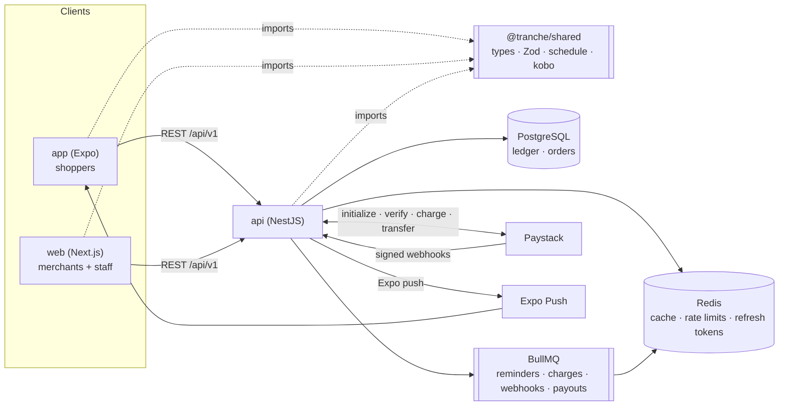
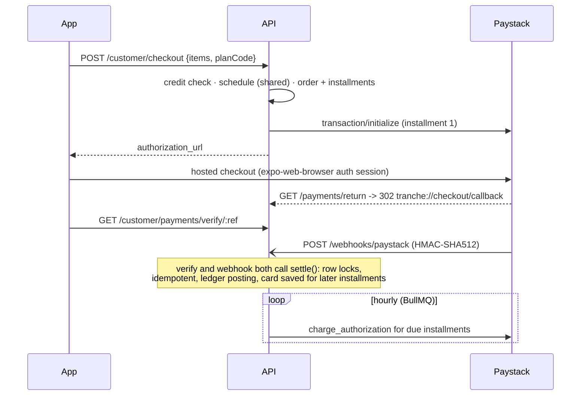

# Tranche

[](https://github.com/OWNER/tranche/actions/workflows/ci.yml)
[](https://codecov.io/gh/OWNER/tranche)


**Buy now, pay in parts.** Tranche is a buy-now-pay-later platform for Nigeria: shoppers split a purchase into four interest-free payments, merchants are paid in full upfront, and Tranche collects the rest.

One product, three apps and a shared contract, in a Turborepo:

| Workspace | What | Stack |
|---|---|---|
| [`app/`](app) | Shopper mobile app: browse, check out with Pay in 4, see the schedule, pay early, push reminders | Expo SDK 57, Expo Router, RTK Query |
| [`web/`](web) | Merchant dashboard, Tranche staff console, marketing site | Next.js 15, React 19, Tailwind v4, RTK Query |
| [`api/`](api) | Payments engine: REST, double-entry ledger, installments, Paystack, webhooks, BullMQ jobs, JWT roles | NestJS 11, PostgreSQL (TypeORM), Redis, BullMQ |
| [`shared/`](shared) | Types, Zod schemas, money and schedule maths used by all three | TypeScript, Zod 4, tsup (CJS + ESM) |
| [`infra/`](infra) | Docker Compose, env templates, ops scripts | Docker, Render, Vercel, EAS |

## Architecture



**Why a shared package matters here:** the installment schedule is computed by one function, `buildInstallmentSchedule`, in `shared/`. The app uses it to preview a plan, the api uses it to create the installments, and the web landing page uses it for its example. All three always agree to the kobo and the day. Request validation works the same way: forms in `app` and `web` validate with the same Zod schemas the api's `ZodValidationPipe` enforces, so a field error looks identical everywhere.

## How the money moves

All amounts are integer **kobo** (`bigint` in Postgres). Every state change that moves money posts a balanced journal entry in the same database transaction:

| Event | Debit | Credit |
|---|---|---|
| First installment paid, order financed | `customer_receivable:<shopper>` total | `merchant_payable:<merchant>` total − fee, `platform:fee_revenue` fee |
| Installment collected | `platform:clearing` | `customer_receivable:<shopper>` |
| Late fee (once, after the grace period) | `customer_receivable:<shopper>` | `platform:late_fee_revenue` |
| Payout to merchant | `merchant_payable:<merchant>` | `platform:clearing` |

Guarantees:
- **Balanced:** checked in code, and by a deferred Postgres constraint trigger that rejects any unbalanced transaction at `COMMIT`.
- **Append-only:** a second trigger blocks `UPDATE`/`DELETE` on `ledger_entries`.
- **Idempotent:** unique `(kind, reference)` on journal transactions, so a replayed webhook can't double-count.
- **Reconcilable:** cached account balances are row-locked and updated in the same transaction. The staff trial balance recomputes from entries and flags any drift.

### Checkout and settlement



Webhooks are **stored, acknowledged, then processed** on a queue. Each event has a unique dedupe key; one that hasn't been processed successfully is retried on redelivery, and one already processed is acknowledged and skipped. The api never trusts a webhook payload: `settle()` re-verifies the amount and status with Paystack.

## Quick start

Prerequisites: Node 24, pnpm 11, and Docker (or your own Postgres 16 and Redis 7).

```bash
pnpm install
pnpm infra:up                                  # Postgres + Redis in Docker
cp api/.env.example api/.env
pnpm --filter api keys:generate >> api/.env    # RS256 JWT keypair + encryption key
pnpm --filter api db:migrate
pnpm --filter api seed                         # catalog, shoppers, 4 months of orders, payouts
pnpm dev                                       # api :4000, web :3000
pnpm dev:app                                   # Expo (set app/.env EXPO_PUBLIC_API_URL to your LAN IP)
```

With no `PAYSTACK_SECRET_KEY`, the api uses an in-memory provider and serves a **test checkout page**, so the whole buy, pay and verify loop works offline. Add Paystack **test** keys to use the real gateway (test card `4084 0840 8408 4081`, any future expiry, CVV `408`, PIN `0000`, OTP `123456`).

| Demo login (password `Tranche123!`) | Where |
|---|---|
| `customer@tranche.ng` | Mobile app |
| `merchant@tranche.ng` | Web, merchant dashboard |
| `admin1@tranche.ng`, `admin2@tranche.ng`, `admin3@tranche.ng` | Web, staff console (super admins, `ADMIN_EMAILS` in the admin seeder) |
| `support@tranche.ng` | Web, staff console (read-mostly support role) |

Queue dashboard (Bull Board): `http://localhost:4000/api/v1/admin/queues` (basic auth from `QUEUE_DASHBOARD_*`).

## Tests

```bash
pnpm turbo run lint typecheck          # every workspace
pnpm --filter @tranche/shared test     # schedule, money, schemas
pnpm --filter api test                 # unit: ledger postings, guards, filter, crypto, Paystack signatures
pnpm --filter api test:int             # integration: Nest app + Supertest against real Postgres + Redis
pnpm --filter api test:all             # both, one coverage report (what CI uploads)
```

The integration suite builds the schema from the real migrations, so the ledger triggers are tested too. It covers:
- **Auth:** refresh rotation and reuse detection, session revocation, RBAC per role and staff tier.
- **Checkout:** the shared schedule, credit limits, cross-customer isolation, maintenance mode.
- **Settlement and webhooks:** signature checks, duplicate and early deliveries, a forged success, double verification.
- **Background jobs:** reminders, the delinquency sweep (overdue, late fee, default), auto-charge with declined cards.
- **Payouts:** capped by the ledger balance.
- **The ledger itself:** the trial balance after each scenario, and that the database rejects unbalanced or edited ledger rows.

## CI/CD

`.github/workflows/`:
- **`ci.yml`** runs on every push and PR:
  - lint and typecheck everywhere
  - shared tests
  - api and web builds
  - api unit and integration tests against Postgres and Redis service containers, a migration drift check (`migration:generate --check`), and coverage uploaded to Codecov
  - the mobile app bundled with `expo export`
  - Docker images built for api and web
- **`deploy.yml`** runs only after CI succeeds on `main`. It triggers the Render deploy hook and waits for `/api/v1/health`, then builds and deploys `web` to Vercel.
- **`eas-build.yml`** runs EAS builds on demand or on an `app-v*` tag.

Repository settings to add:

| Kind | Name | For |
|---|---|---|
| Secret | `RENDER_DEPLOY_HOOK_URL` | api deploy (Render, Settings, Deploy hook) |
| Secret | `VERCEL_TOKEN`, `VERCEL_ORG_ID`, `VERCEL_PROJECT_ID` | web deploy (project root directory: `web`) |
| Secret | `EXPO_TOKEN` | EAS builds |
| Secret | `CODECOV_TOKEN` | coverage badge |
| Variable | `API_URL` | health check after deploy |

The api deploys from [`render.yaml`](render.yaml): one Docker service running HTTP and workers, managed Postgres, and Key Value (Redis, `noeviction`). The container runs migrations on boot, and with `SEED_ON_BOOT=demo` seeds the demo data once on an empty database.

## Repository conventions

The layout and idioms deliberately mirror an existing production codebase:
- **Audience-scoped api modules:** `global` (public and any signed-in user), `customer`, `merchant`, `admin`. Each module has `controllers/`, `services/` and `repositories/`.
- **Naming:** files are kebab-case with a dot suffix (`checkout.service.ts`). Repositories extend one `BaseRepository` with `findPaginated` and Redis read-through caching.
- **Response envelopes:** `{ success, response, message? }` on success, `{ success: false, error: { message, code, details? }, timestamp, requestId }` on error.
- **Client data layer:** RTK Query with one `createApi` per api area, endpoints injected from per-resource files, and a single-flight token refresh.
- **UI:** hand-built kits (`web/components/ui`, `app/src/ui`) driven by design tokens; no component library.

See [`app/AGENTS.md`](app/AGENTS.md) and [`app/DESIGN.md`](app/DESIGN.md) for UI rules, and each workspace's README for details.
